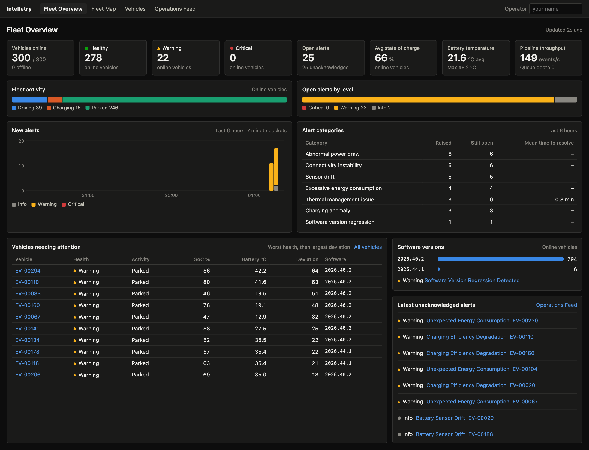
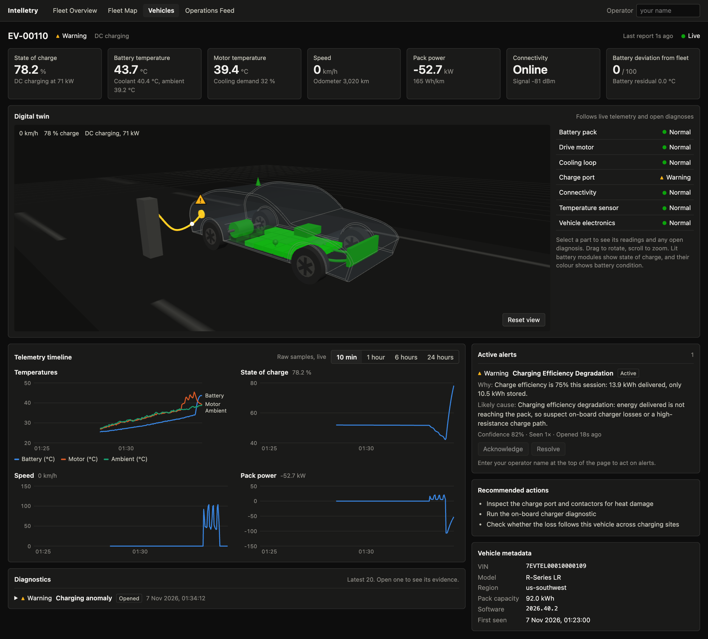
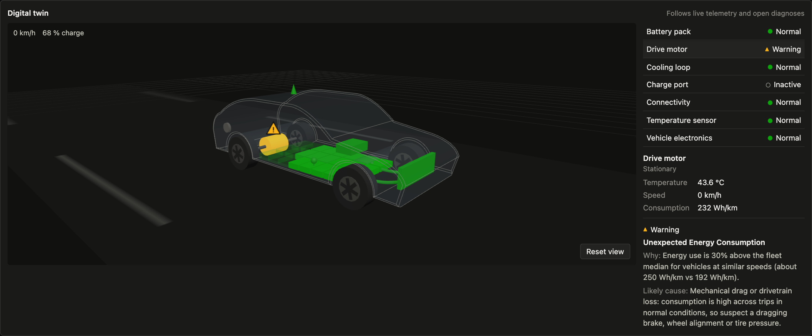
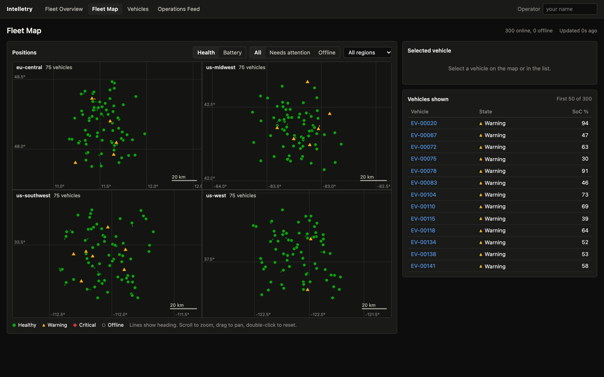
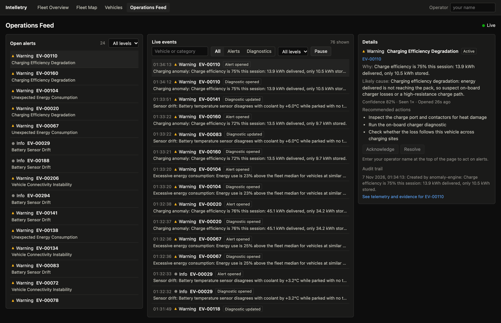

# EV Telemetry Intelligence Platform

A connected-vehicle telemetry platform that explains why a vehicle is behaving abnormally, not just what its sensors read.

**Status:** the backend pipeline, fleet dashboard, 3D digital twin and Azure deployment setup are built. The deployment setup has been validated but not yet run against a real Azure subscription.

## Screenshots

All data comes from the simulated fleet, running through the full pipeline.

**Fleet overview:** fleet health, open alerts, pipeline throughput and software versions, including a detected software regression.



**Vehicle detail:** live telemetry, the digital twin, the alert explaining the problem and what to do about it. This vehicle is losing about a quarter of its energy while DC charging.



**Digital twin:** an interactive 3D model driven by live telemetry. Each diagnosis appears on the part it concerns, with its likely cause.



**Fleet map:** live positions by region, coloured by health or battery state.



**Operations feed:** real-time alerts and diagnostics, with acknowledge, resolve and an audit trail.



## Run it locally

Requires Go, Redis, PostgreSQL 16 and Node 22+ (`brew install go redis postgresql@16 node`). No Docker needed.

```bash
scripts/local.sh up 300     # start the backend with 300 simulated vehicles
scripts/local.sh dashboard  # run the dashboard at http://localhost:3000
python3 scripts/score_live.py   # compare live alerts with the injected faults
scripts/local.sh down       # stop everything and delete local data
```

## Run the tests

```bash
scripts/local.sh test
```

## Benchmark ingestion

```bash
scripts/bench.sh
```

Ingestion sustained 500,000 events/s under 20 ms p99 with no lost events on one laptop. See [the results and their limits](docs/benchmarks.md).

## Dashboard access

The dashboard has no sign-in yet. The operator name on alert actions is typed in by the user and is not verified, so a real deployment needs Microsoft Entra ID or similar in front of it.

## Deploy to Azure

Docker images, Kubernetes manifests, Bicep, Flux and GitHub Actions are set up for AKS. See [the deployment guide](docs/deployment.md) for how they fit together, how to do the first deployment, and the known gaps.

```bash
scripts/validate-manifests.sh   # build and schema-check every Kubernetes and Flux entry point
```
